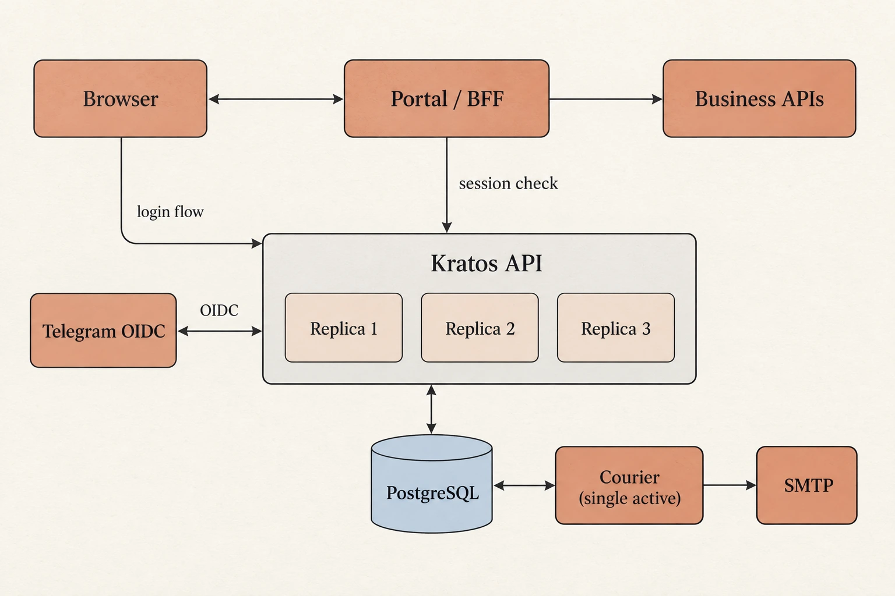
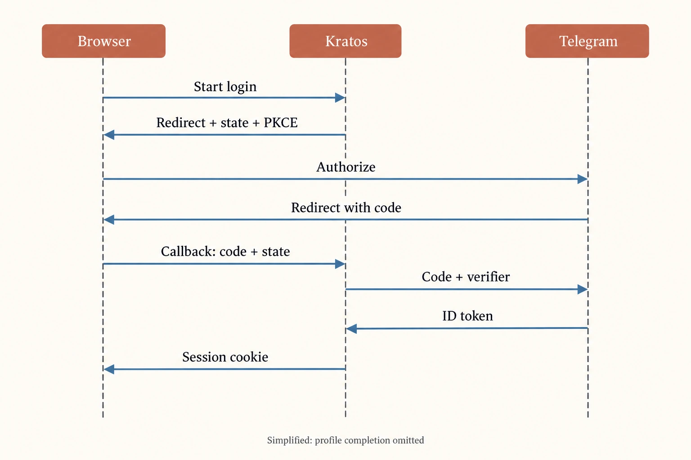

为高可用 Kratos 接入 Telegram


我们的目标，是为折光实现一套高可用、高安全性的统一认证服务。身份、登录流程与会话由同一套基础设施管理，各个应用在此之上执行自己的准入政策，不再分别维护一套账号系统。

Telegram 登录是这套服务的第一个具体接入场景。我们复用部署在 Kubernetes 上的 Kratos，让门户负责页面和业务权限。高可用意味着副本替换时登录事务仍能继续；高安全性意味着身份声明、会话来源与业务权限都经过后端校验。它们是这次建设的目标，不能仅凭三个 Pod 或一次登录成功就宣布全部达成。

这次接入分成了两段工作。先把 Kratos API 调整为跨节点的三个副本，检查登录流程能否在副本之间继续。再接入 Telegram OIDC，完成身份映射，并在门户后端限制登录来源。

配置并不是最费时间的部分。第一次副本驱逐测试留下了一次超时；第一次真实 Telegram 登录，则因为浏览器里的旧流程已经过期而失败。下面按实际实施顺序说明这些问题，以及我们如何判断每一步是否完成。

## 我们把哪些事情交给 Kratos

门户需要解决三个不同的问题：用户是谁、是否已经登录，以及是否有权开通媒体服务账号。

Telegram 提供外部身份。Kratos 将它关联到本站 identity，管理登录流程与会话。门户读取经过验证的会话，再检查自己的准入条件。指定群组成员资格、服务器政策等条件仍属于业务逻辑。



图中表示组件职责与逻辑依赖，省略了入口代理及数据库复制拓扑；不代表所有门户功能都已在生产启用。Telegram 的浏览器跳转与服务端换码过程见下方时序图。

这里的 Kratos 是 OIDC 客户端。它向 Telegram 发起认证请求，并建立本站会话；它不是给其他应用签发 OAuth access token 的授权服务器。因此，这次接入不需要先增加 Hydra。

采用这种分工，也让后续调整比较局部。我们可以让门户只接受 Telegram 登录，而不必关闭共享 Kratos 中其他应用仍在使用的密码登录。

## 先验证跨副本的登录流程

本次使用 Kratos v26.2.0。API 调整为三个副本，分布在三个节点。滚动更新配置为 `maxSurge: 1`、`maxUnavailable: 0`，PDB 则为自愿中断设置至少保留两个健康副本的约束。

数据库迁移单独通过升级前的 Job 执行，不再让每个 API Pod 的启动都承担迁移工作。这样，扩容和替换副本不会同时触发多份迁移任务。


部署完成后，我们没有只检查 Pod 是否 Ready，而是先创建一条登录流程，再分别通过其他副本读取。记录显示，这条流程能在不同副本间接续；副本替换之后，也仍然能够读取。

接下来才是驱逐测试。第一次驱逐后，副本约 8.4 秒恢复。公网的 40 次健康请求全部成功，内部的 100 次请求中却有一次超过 5 秒。第二次分路径检查的 210 次请求全部成功，没有复现超时。

我们没有把后一次全绿作为删除前一次失败的理由。现有证据支持副本替换与恢复机制已经工作，但不足以声称无损切换，更不能把短时健康请求采样当作真实用户登录的长期成功率。

这轮工作也没有演练数据库、整机和区域故障。Courier 仍为单副本。本文所说的高可用，主要指 Kratos API 层的冗余，以及已经检查过的跨副本和滚动恢复行为。

## 使用 Telegram 的原生 OIDC 流程

我们选择标准授权码流程，没有另外实现旧版 Login Widget 的签名校验。

Telegram 当前官方文档提供 OIDC discovery，支持授权码与 PKCE S256，默认使用 RS256 签名。它把用户资料放在 ID token 中，没有单独的 UserInfo 端点。[官方文档](https://core.telegram.org/bots/telegram-login)

对应到 Kratos，我们使用 generic provider，从 ID token 读取声明，申请 `openid profile`，并强制 PKCE。Client ID 和 Client Secret 来自 BotFather 的登录设置，Secret 只在服务端使用。



这张图省略了首次注册的补资料步骤。PKCE 跳转携带的是 challenge，verifier 留在服务端；只有 token 校验和必要的注册步骤完成后，才建立会话。

这里有两个配置细节值得单独检查。

首先是回调地址。在我们使用的版本与 PKCE 配置下，登记的是不带 provider ID 后缀的回调。我们检查 Kratos 实际生成的授权请求，再与 BotFather 登记项逐字比对，没有凭印象在路径后加上 `/telegram`。其他版本或配置应重新检查，不能直接套用这个结论。

其次是用户资料来源。既然 Telegram 没有独立 UserInfo 端点，客户端就不能依赖一次额外的 userinfo 请求来补齐资料。我们的映射使用经过校验的 ID token，外部身份键是 `(issuer, sub)`。

Bot API 使用的 Telegram user ID 单独保存，不默认与 OIDC subject 等同。用户名、昵称和头像也不参与自动合并账号。针对较大的数字 ID，mapper 测试检查了精确保留，避免中间的浮点数转换改变身份标识。

配置上线时，我们验证了授权跳转中的 state、S256、scope 和回调。错误 state 被拒绝，未完成授权的流程仍没有登录态。不过，能打开 Telegram 授权页只说明前半段连通。真实授权码兑换，仍需用户完成授权后继续验证。

## 一个过期了 373 分钟的流程

服务端配置完成后，浏览器停在 Telegram 授权页，等待用户确认。等到继续操作时，页面报错了。

我们沿错误 ID 查看服务端记录，得到的是：

```text
error.id = self_service_flow_expired
HTTP status = 410
expired 373.02 minutes ago
```

373 分钟是流程已经过期的时长，不是整个流程的持续时间。


处理方式是重新建立登录流程。没有更换密钥，没有放宽 state 检查，也没有修改现有邮箱要求。用户从新的 Telegram 授权页继续，随后反馈登录成功。这次配置的流程有效期为一小时。

这次排查也补充了门户页面的要求：流程过期时，应提供明确的重新开始入口，而不是让用户一直刷新旧错误页。对于尚未成功提交的邮箱等资料，界面尽量保留输入，但不能复用已经失效的认证事务。

## Telegram-only 要在后端执行

门户最初计划同时提供 Telegram 与密码入口，后来需求明确为只接受 Telegram。

删掉密码输入框并不够。共享 Kratos 仍支持密码登录，已经存在的密码会话也不会因为前端按钮消失而失效。

我们在门户后端检查 Kratos 原生会话的认证来源，要求其经过 Telegram OIDC。用户可编辑资料里出现 Telegram 字段，不会被当作有效的认证证据。


隔离测试里，我们创建了真实的密码来源会话。Kratos 认为它有效，门户返回 403。这个结果符合预期：共享身份服务保留原有能力，具体应用执行自己的登录政策。

已有账号绑定同样需要显式认证，不能因为同名或相同邮箱自动合并。登录之后是否满足群组成员等条件，也继续由业务层检查，不从 OIDC 成功直接推导。

## 邮箱资料与验证


Telegram 登录没有提供能直接满足我们 schema 的邮箱，而原有 Kratos schema 要求该字段。我们保留了约束，让新用户在外部授权之后补填邮箱，没有编造地址，也没有直接放宽共享 schema。

随后又补上了邮箱归属验证。验证码和邮件队列复用 Kratos 原生流程与 Courier，不再额外维护一套 OTP 服务。未验证邮箱的会话会被后端拦截；邮箱验证码也不能独立用于登录。

这部分有两个不同的完成状态：隔离环境已经验证实际邮件收取、错误验证码、重发与过期恢复；生产环境在记录末尾只启用了 SMTP 传输配置，并通过连接认证检查。没有发送生产测试邮件，门户页面及邮箱验证配置也没有在那次操作里一并上线。

因此，SMTP 连通不能算作实际送达验收。

## 我们怎样测试

门户集成测试使用真实 Kratos、临时 PostgreSQL 和本地签名的 OIDC fixture，走通 PKCE、签名 token、补资料、会话建立和退出。它验证的是组件之间的集成，不是每次测试都登录真实 Telegram。

初期浏览器回归有 68 项，后续加入邮箱验证后增长到 112 项，覆盖桌面、手机、平板和窄屏。后端还有 Go race 检查，以及显式使用隔离数据库的回归。我们更关心这些检查覆盖了什么，而不是数字本身：

- 密码来源会话是否被门户拒绝。
- 外部授权未完成时，能否绕过流程提交资料。
- 页面显示验证成功后，后端是否确认了实际身份状态。
- 流程过期、用户取消或服务不可用时，页面能否正确恢复。

我们还并行处理了 Cap 的防滥用与高可用问题。它不负责认证 Telegram 身份，实施和测试也相对独立，适合留到另一篇展开。

## 目前做到哪一步

Kratos API 三副本与 Telegram 服务端配置已部署，重建过期流程后有用户登录成功的反馈。Telegram-only 门户与邮箱验证完成了隔离验收，但尚未随本次操作上线。生产 SMTP 通过连接认证检查，实际收件仍待验证。

仍需继续解释的还有第一次驱逐测试中的超时。第二次没有复现，只能缩小线索，不能替代原因定位。

对于已有 Kubernetes 和身份服务的项目，这种接入方式能复用不少基础设施。但小型单实例站点没必要为了一个登录按钮照搬三节点部署。我们认为更值得复用的是验收方法：检查具体的登录事务，检查后端是否真正执行准入政策，并把隔离测试与生产结果分开记录。

## 补充：生产故障演练的实测结果（2026 年 10 月 15 日）

之前我们说“三副本”时，只证明了 Kratos 这一层有冗余。这次在生产环境做了一轮演练。演练期间一直有合成认证请求在跑（创建登录流程，会读写数据库），所以下面的失败率是这些请求实测得到的，不是看健康检查得出的。

| 演练 | 恢复情况 | 合成请求失败 |
| --- | --- | --- |
| Kratos 滚动重启 | 21.7 秒完成 | 0 / 49 |
| 通过 Eviction API 主动驱逐一个 Kratos Pod | 12.4 秒恢复三副本 | 0 / 37 |
| 入口 Tunnel connector 改为三副本并滚动更新 | 无路由丢失 | 0 / 98（1 次超过 2 秒） |
| Kratos 改连独立连接池（PgBouncer，session 模式，两实例） | 切换无中断 | 0 / 54 |
| Courier 进程中断 | 4.9 秒恢复，始终只有一个 worker | 当时队列为空，没能验证补发 |
| PostgreSQL 计划内主从切换（做了两次） | 约 28 秒集群恢复健康 | 写失败窗口约 12～14 秒，期间约 20%～25% 的请求返回 500 |

从备份恢复数据库的演练：在单独的命名空间里新建一个临时集群，从现有对象存储中的全量备份和 WAL 恢复，完成后删除。数据库约 3.7 GB，需要重放约 20 小时的 WAL。

- RTO：恢复任务实际开始到数据库可读写用了约 15 分钟。整个演练耗时约 27 分钟，其中约 11 分钟浪费在临时存储卷的调度问题上。真实故障时还要加上判断故障和切换应用连接的时间，所以 RTO 应该按“半小时级”来估计。
- RPO：恢复出的数据比恢复完成时刻落后约 3 分钟。WAL 归档的超时设为 5 分钟，因此理论上最多会丢失约 5 分钟的数据。数据库没有配置同步副本，主库突然损坏时 RPO 不为零。

目前已经实现高可用的部分：Kratos API 三副本，滚动和驱逐都没有失败；入口 Tunnel connector 三副本，强制分布在不同节点，并设置了 PDB；连接池两实例分布在不同节点；Kratos 由 GitOps 管理，网络策略默认拒绝，只放行必要的流量。

仍然不是高可用、或者还没有验证的部分：

- 数据库主切换会造成十几秒的写失败。session 模式的连接池不会在切换期间把请求排队，所以不能缩短这个窗口。
- 备份和数据库在同一个云区域，没有异地副本。区域级故障时无法按上面的 RTO 恢复。我们评估过跨区域复制，因为成本问题暂时没有做。
- 整机突然宕机还没有演练。每个数据库节点上都还有绑定在本节点的单实例服务，现在 drain 一台节点会连带影响其他业务。
- Courier 按官方要求保持单实例，补发能力还没有在真实积压的情况下验证。邮件实际送达同样还没有验收。

### 参考

- [Telegram：Log In With Telegram](https://core.telegram.org/bots/telegram-login)
- [Ory：接入通用 OpenID Connect 提供方](https://www.ory.com/docs/kratos/social-signin/generic)
- [Ory Kratos](https://www.ory.com/kratos)

配图由 AI 生成。
